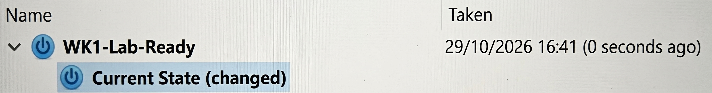

# NetworkWalks Cybersecurity Internship — Week 1

## Project: Kali Linux Lab Setup and Network Verification

## Overview

This project focuses on preparing a Kali Linux environment for cybersecurity exercises, network troubleshooting, and penetration-testing practice.

The initial setup involved configuring network connectivity, verifying IP addressing and routing, testing external reachability, checking DNS resolution, and creating a recovery snapshot.

## Objectives

- Configure Kali Linux networking for internet access.
- Inspect IP addressing and routing.
- Verify gateway and external connectivity.
- Test DNS resolution and HTTPS connectivity.
- Create a snapshot for recovery before further lab changes.
- Document the configuration and verification results.

## Lab Environment

| Component | Configuration |
|---|---|
| Operating System | Kali Linux |
| Network Interface | `eth0` |
| Network Configuration | DHCP via NetworkManager |
| IPv4 Address | `192.168.154.132/24` |
| Default Gateway | `192.168.154.2` |
| Subnet | `192.168.154.0/24` |
| Snapshot | `Kali - NetworkWalks Baseline` |

## Implementation

### 1. Kali Linux Startup

Kali Linux was started successfully and prepared for network configuration and connectivity testing.


.

### 2. Network Configuration

The active interface, assigned IP address, and routing table were inspected using:

```bash
ip -br addr
ip route
nmcli device status
nmcli connection show eth0
```
The interface `eth0` received an IPv4 address through DHCP.


### 3. Gateway Connectivity

The default gateway was tested using:

```bash
ping -c 3 -W 2 192.168.154.2
```

**Result:** Three replies were received with 0% packet loss.


### 4. External Connectivity and DNS Resolution

External network connectivity and DNS resolution were tested using:

```bash
ping -c 3 -W 2 1.1.1.1
getent hosts google.com
```

**Results:**
- External IP connectivity succeeded with 0% packet loss.
- DNS resolution succeeded and returned an IPv6 address for `google.com`.


### 5. HTTPS Connectivity

An HTTPS request was attempted using:

```bash
curl -I --max-time 10 https://www.google.com
```

The command checks HTTPS connectivity and displays the server's response headers. The exact HTTP response status was not recorded in the available results.


## Verification Summary

| Test | Result |
|---|---|
| Network interface | `eth0` up |
| DHCP address assignment | Successful |
| Gateway connectivity | Passed |
| External IP connectivity | Passed |
| DNS resolution | Passed |
| HTTPS request | Attempted; response status not confirmed |

## Snapshot and Recovery

A snapshot named `Kali - NetworkWalks Baseline` was created after NAT connectivity was established.




## Remaining Work

The following items require separate verification before being reported as completed:

- Static IPv4 configuration, if required by the assignment.
- Shared-folder configuration and file access.
- Shared clipboard functionality.
- Drag-and-drop functionality.
- Any additional lab-specific networking requirements.
- Confirmation of the HTTPS response status.

## Skills Practiced

- Linux network-interface inspection.
- NetworkManager configuration.
- DHCP and IPv4 troubleshooting.
- Routing-table analysis.
- Gateway and external connectivity testing.
- DNS diagnostics.
- HTTPS connectivity testing.
- Virtual-machine snapshot and recovery planning.
- Technical documentation and evidence collection.

## Conclusion

The initial lab setup established network connectivity for Kali Linux. Gateway reachability, external IP connectivity, and DNS resolution were verified, and a recovery snapshot was created.

This environment provides a starting point for the remaining cybersecurity internship exercises.


