# NetworkWalks Cybersecurity Internship — Week 2

## Project: Website Footprinting, OSINT and Network Discovery

## Overview

This week focused on collecting publicly available information about a target domain and discovering devices on a local network. The exercises used command-line reconnaissance tools, Maltego for visual OSINT analysis, theHarvester for domain intelligence gathering, and Zenmap/Nmap for network discovery.

The activities covered domain registration data, web technology identification, DNS queries, HTTP response headers, web application firewall fingerprinting, DNS enumeration, email discovery, subdomain collection, and live-host discovery.

## Objectives

- Retrieve domain registration information using WHOIS.
- Identify web technologies and server information.
- Inspect DNS records and resolve domain names.
- Examine HTTP response headers and redirects.
- Identify web application firewall technologies.
- Perform DNS enumeration and record any lookup limitations.
- Use Maltego to visualize domain-related email addresses.
- Use theHarvester to collect domain-related information from search sources.
- Discover live hosts and MAC-address information on a local subnet using Zenmap/Nmap.
- Generate a network topology report in Zenmap.
- Document the commands, observed results, and supporting evidence.

## Lab Environment

| Component | Configuration |
|---|---|
| Operating System | Kali Linux |
| Network Discovery Tool | Zenmap / Nmap |
| OSINT Visualization Tool | Maltego Graph Desktop 4.14.0 |
| Domain Footprinting Target | `networkwalks.com` |
| theHarvester Target | `microsoft.com` |
| theHarvester Version | `4.10.1` |
| Local Network Subnet | `10.0.2.0/24` |
| Nmap Version | `7.98` (shown in Zenmap output) |

## Implementation

### 1. Website Footprinting

The following tools were used against `networkwalks.com` to collect domain-registration, web-server, DNS, HTTP, WAF, and DNS-enumeration information.

#### 1.1 WHOIS Lookup

WHOIS was used to retrieve the domain's registration information.

**Command:**

```bash
whois networkwalks.com
```

**Observed results:**

- Domain: `NETWORKWALKS.COM`
- Registrar: GoDaddy.com, LLC
- Creation date: `2019-11-06`
- Registry expiry date: `2027-11-06`
- Name servers: `NS6135.HOSTGATOR.COM` and `NS6136.HOSTGATOR.COM`
- DNSSEC: unsigned

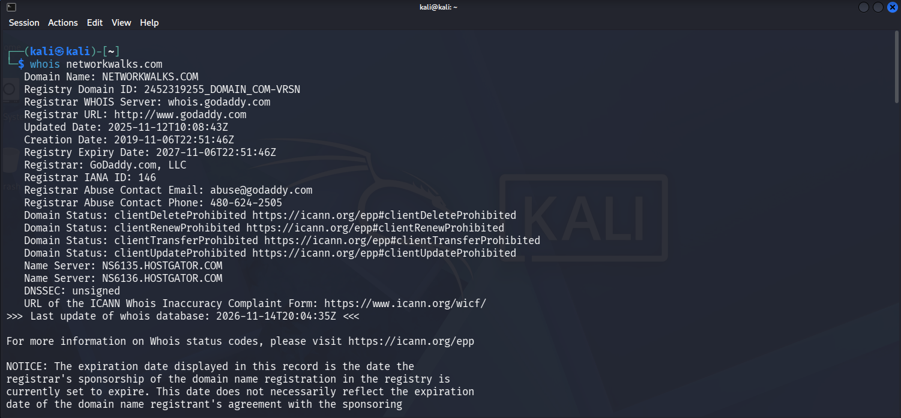

#### 1.2 Web Technology Fingerprinting

WhatWeb was used to identify technologies and metadata exposed by the website.

**Command:**

```bash
whatweb networkwalks.com
```

**Observed results:**

- The HTTP endpoint returned `301 Moved Permanently` and redirected to HTTPS.
- The HTTPS endpoint returned `200 OK`.
- Apache was identified as the web server.
- WordPress `7.1.4` and Bootstrap `7.1.4` were detected.
- The page title was `NetworkWalks Academy`.
- The output exposed the public IP address `192.232.216.135`.

These are fingerprinting observations from the scan output, not a security assessment of the identified components.

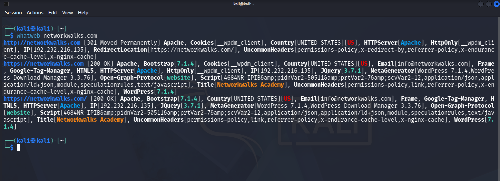

#### 1.3 DNS Lookup

DNS records were queried to identify the domain's resolved addresses and mail exchanger.

**Commands:**

```bash
host networkwalks.com
nslookup networkwalks.com
```

**Observed results:**

- IPv4 address: `192.232.216.135`
- IPv6 address: `64:ff9b::c0e8:d887`
- Mail exchanger: `mail.networkwalks.com` (priority `0`)
- The `nslookup` response was returned by the configured DNS server at `192.168.154.2`.

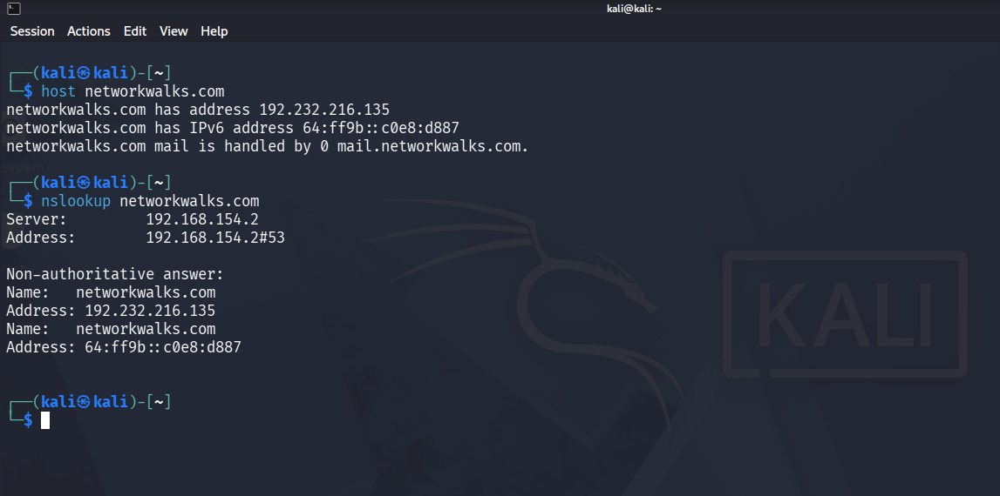

#### 1.4 HTTP Response Header Inspection

cURL was used to inspect the HTTP response headers and observe the site's redirect behavior.

**Command:**

```bash
curl -I networkwalks.com
```

**Observed result:**

The server returned `HTTP/1.1 301 Moved Permanently` and supplied the redirect destination:

`https://networkwalks.com/`

The response also exposed headers including the Apache server identification, content type, and WordPress-related headers.

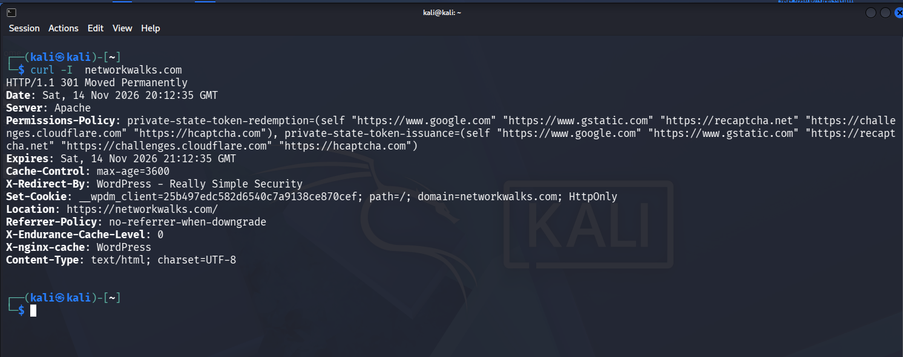

#### 1.5 Web Application Firewall Fingerprinting

Wafw00f was used to check whether the website was protected by a recognizable web application firewall.

**Command:**

```bash
wafw00f networkwalks.com
```

**Observed result:**

Wafw00f identified the website as being behind **ModSecurity (SpiderLabs)**. The tool reported two requests during the check.

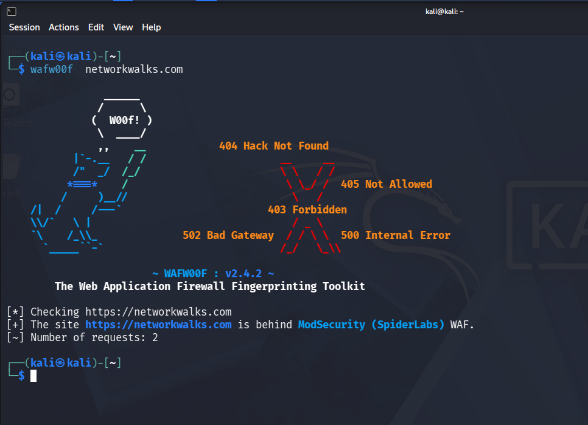

#### 1.6 DNS Enumeration

DNSRecon was used to perform general enumeration against the target domain.

**Command:**

```bash
dnsrecon -d networkwalks.com
```

**Observed result:**

The tool started general enumeration but reported a timeout while querying the target DNS servers. The output recommended increasing the timeout using the `--lifetime` option.

The enumeration therefore did not produce a confirmed set of DNS records in the captured run. This limitation is recorded rather than treating the task as a successful enumeration.

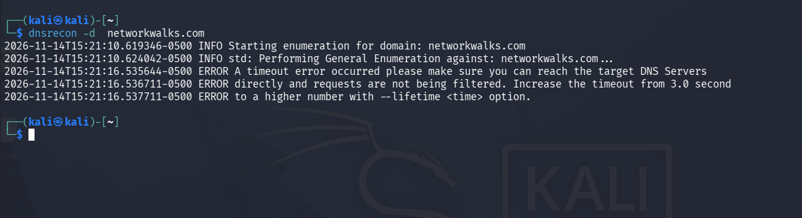

### 2. Google Dorking

This activity was not completed as part of the submitted Week 2 work and is therefore not reported as performed.

### 3. Maltego — Domain and Email Discovery

#### 3.1 Maltego Installation Check

The Maltego installer was launched on Windows. The installer reported that Maltego was already installed and requested that the existing installation be removed before running the installer again.

This confirms that an existing installation was detected; the screenshot does not show a new installation being completed.

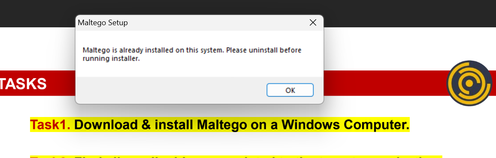

#### 3.2 Domain Email Discovery

Maltego Graph Desktop 4.14.0 was used to investigate `networkwalks.com`. The graph shows the domain entity connected to two email-address entities.

**Observed email addresses:**

- `abuse@godaddy.com`
- `info@networkwalks.com`

The transform output indicates that the email addresses were obtained using the **To Email address [From whois info]** transform.

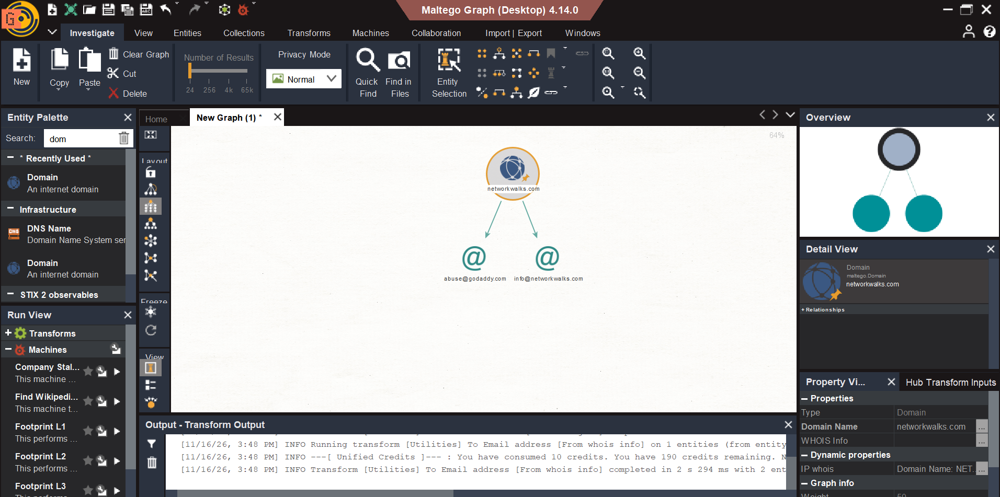

### 4. theHarvester — Domain Intelligence Gathering

TheHarvester `4.10.1` was used against `microsoft.com` for the two assigned source configurations.

#### 4.1 Baidu Source — Limit 1000

**Command:**

```bash
theHarvester -d microsoft.com -b baidu -l 1000
```

**Observed results:**

- Target: `microsoft.com`
- Source: Baidu
- Result limit: `1000`
- No IP addresses, email addresses, or people were returned in the captured run.
- Five hosts/subdomains were reported:
  - `2Fsupport.microsoft.com`
  - `account.microsoft.com`
  - `developer.microsoft.com`
  - `support.microsoft.com`
  - `support.serviceshub.microsoft.com`

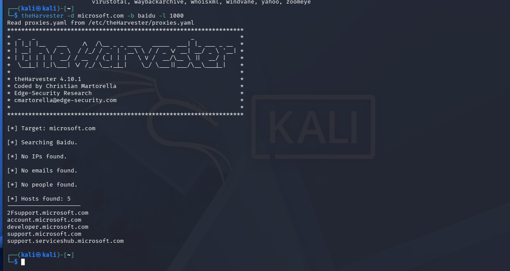

#### 4.2 All Sources — Limit 50

**Command:**

```bash
theHarvester -d microsoft.com -b all -l 50
```

**Observed results:**

The command was executed with the `all` source selection and a limit of `50`. The captured output shows theHarvester attempting multiple source integrations. Several providers reported missing API keys or provider-specific errors, including BeVigil, Bitbucket, BufferOverrun, BuiltWith, and Brave Search.

The screenshot captures the provider warnings but does not show a complete final result summary. Therefore, no total number of discovered hosts, emails, or IP addresses is claimed for this run.

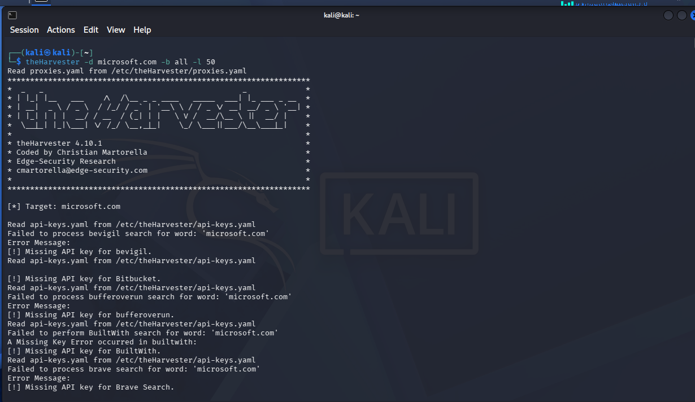

### 5. Zenmap / Nmap — Local Network Discovery

Zenmap was used to scan the local subnet and identify active hosts.

#### 5.1 Host Discovery

**Target subnet:**

`10.0.2.0/24`

**Nmap command:**

```bash
nmap -sn 10.0.2.0/24
```

The `-sn` option performs host discovery without a port scan.

**Observed results:**

Zenmap displayed three live hosts:

| Host IP | Status | MAC address shown |
|---|---|---|
| `10.0.2.2` | Up | `52:54:00:12:35:00` |
| `10.0.2.3` | Up | `52:54:00:12:35:00` |
| `10.0.2.15` | Up | Not shown in the captured output |

The Nmap output reported that 256 IP addresses were scanned and three hosts were up. The same MAC address appears in the captured output for `10.0.2.2` and `10.0.2.3`; the README preserves the displayed output rather than assuming the reason for this duplication.

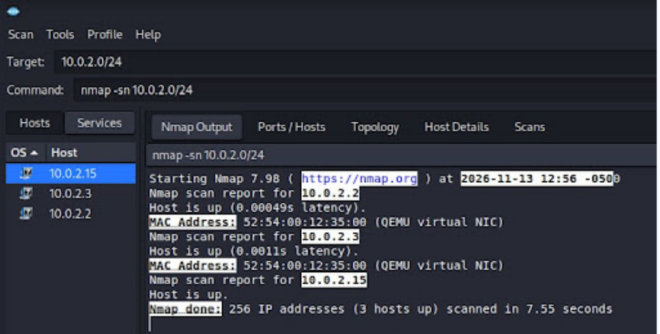

#### 5.2 Network Topology

The network-topology visualization and PDF export were completed in Zenmap as part of the assigned exercise. The supplied screenshot documents the host-discovery output; it does not show the topology view or the exported PDF.

## Verification Summary

| Activity | Result |
|---|---|
| WHOIS lookup | Completed; registration details retrieved |
| WhatWeb fingerprinting | Completed; Apache, WordPress and Bootstrap identified |
| DNS lookup | Completed; IPv4, IPv6 and mail exchanger returned |
| cURL header inspection | Completed; HTTP 301 redirect to HTTPS observed |
| Wafw00f fingerprinting | Completed; ModSecurity (SpiderLabs) identified |
| DNSRecon enumeration | Attempted; DNS query timed out |
| Maltego installation check | Existing installation detected |
| Maltego email discovery | Completed; two email entities shown in graph |
| theHarvester — Baidu | Completed; five hosts reported |
| theHarvester — all sources | Executed; provider API-key warnings shown; final totals not visible |
| Zenmap host discovery | Completed; three live hosts identified |
| Zenmap topology PDF | Reported completed; topology/PDF evidence not included in supplied screenshots |
| Google Dorking | Not completed |

## Remaining Work

The following points remain open based on the available evidence:

- Repeat DNSRecon with an appropriately increased timeout if a complete DNS enumeration result is required.
- Configure API keys for the theHarvester providers that require them, if further source results are required.
- Add the Zenmap topology screenshot and exported PDF to the repository if they are available.
- Google Dorking was not completed.

## Skills Practiced

- WHOIS-based domain registration research.
- Web technology and server fingerprinting.
- DNS lookup and mail-exchanger identification.
- HTTP response-header inspection and redirect analysis.
- Web application firewall fingerprinting.
- DNS enumeration and troubleshooting.
- OSINT graph analysis with Maltego.
- Email and subdomain discovery with theHarvester.
- Network host discovery with Zenmap/Nmap.
- MAC-address observation and network topology reporting.
- Technical documentation and evidence collection.

## Conclusion

Week 2 provided practical experience with website footprinting, OSINT, domain intelligence gathering, and local network discovery. The exercises identified registration information, web technologies, DNS information, an HTTP-to-HTTPS redirect, a ModSecurity fingerprint, email addresses associated with the target domain, and five Microsoft-related hosts from the Baidu search.

The work also exposed practical limitations: DNSRecon timed out, and several theHarvester integrations required API keys. These limitations are documented explicitly. Zenmap identified three live hosts on the scanned subnet, and the topology PDF exercise was reported as completed.

---

**Internship:** NetworkWalks Cybersecurity Internship
**Week:** 02
