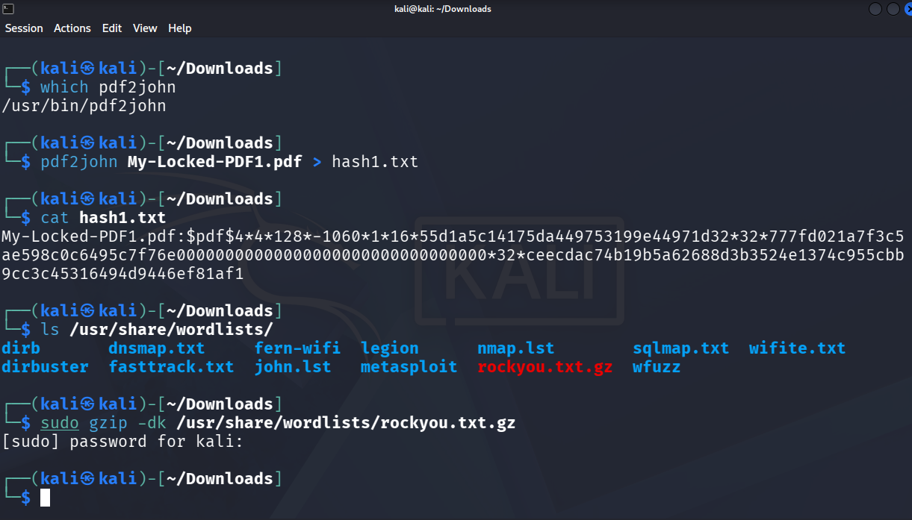
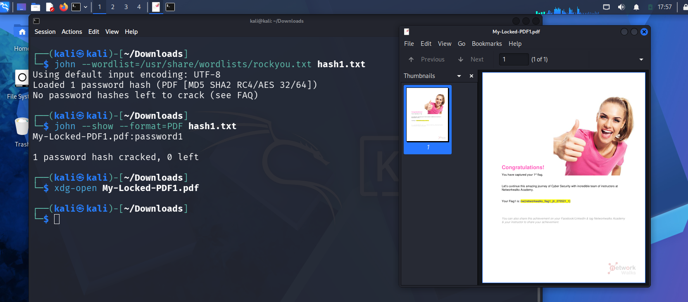
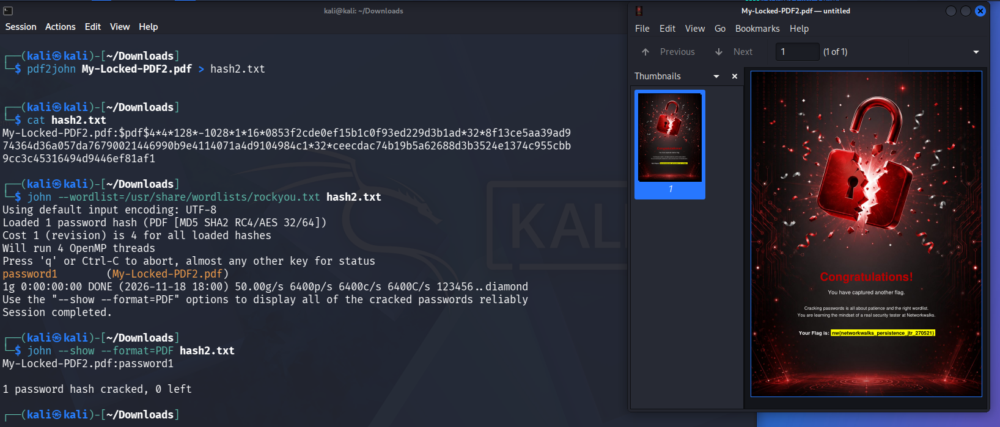
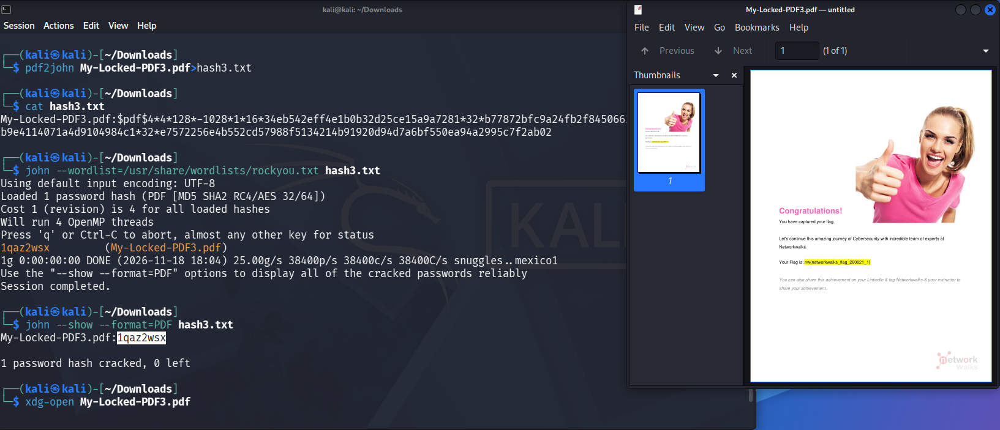
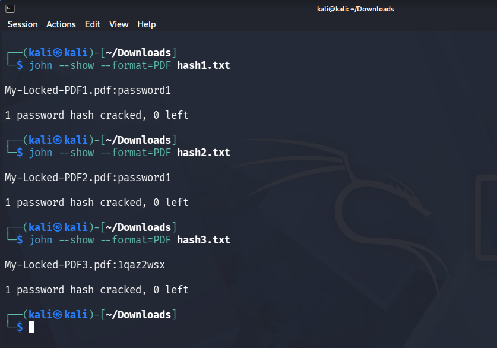
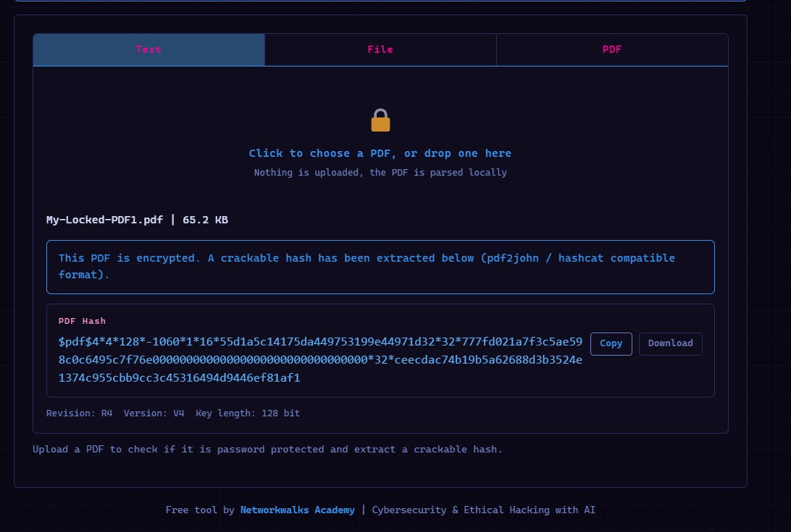
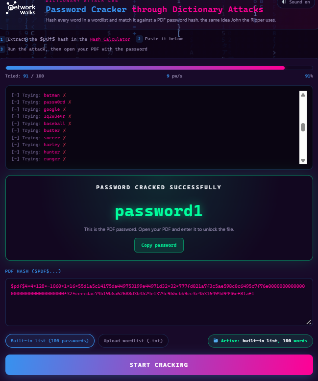

# NetworkWalks Cybersecurity Internship — Week 3

## Password Cracking Lab

**Modules completed:**
- W3-PM1 — Password Cracking with John the Ripper (JTR)
- W3-PM2 — Password Cracking with NetworkWalks Tools

## 1. Overview

Week 3 focused on recovering passwords from three password-protected training PDFs using dictionary-based attacks.

The practical work covered offline password cracking with John the Ripper and browser-based hash extraction and password cracking with NetworkWalks tools. All activities were performed against training files supplied for the internship.

## 2. Tools and Environment

- Kali Linux
- pdf2john
- John the Ripper
- rockyou.txt
- NetworkWalks Hash Calculator
- NetworkWalks Password Cracker

---

## 3. W3-PM1 — Password Cracking with John the Ripper

### Step 1 — Environment verification and preparation

Verified the required tools, extracted the first PDF hash and prepared the wordlist.



### Step 2 — PDF 1 recovery

Retrieved the previously recovered result from John's pot file, opened the PDF and captured its flag.



### Step 3 — PDF 2 recovery

Extracted the hash and performed a dictionary attack using rockyou.txt.



### Step 4 — PDF 3 recovery

Repeated the hash extraction and dictionary attack workflow.



### Step 5 — Consolidated verification

Verified all three recovered results using `john --show`.



**W3-PM1 result:** All three training PDFs were successfully recovered.

---

## 4. W3-PM2 — Password Cracking with NetworkWalks Tools

### Step 1 — Hash Calculator

Extracted a PDF-compatible hash using the NetworkWalks Hash Calculator.



### Step 2 — Password Cracker

Submitted the extracted hash to the NetworkWalks Password Cracker and performed a dictionary attack using its built-in wordlist.



**W3-PM2 result:** Successful recovery on PDF 1, matching the result obtained with John the Ripper.

*Note: The NetworkWalks online workflow was demonstrated on PDF 1 only.*

---

## 5. Technical Findings

- `pdf2john` extracts the data required for password testing; it does not crack passwords itself.
- Dictionary attacks depend on whether the password exists in the selected wordlist.
- John the Ripper supports offline attacks using larger wordlists.
- NetworkWalks provides a guided browser-based workflow.
- PDF 1's John result was retrieved from the pot file; live dictionary attacks were captured for PDFs 2 and 3.

## 6. Security Recommendations

- Use long, unique and unpredictable passwords.
- Avoid common dictionary words and keyboard patterns.
- Never reuse passwords across sensitive documents.
- Use a password manager.
- Apply appropriate access controls to sensitive files.

## 7. Repository Structure

```text
week-3/
├── README.md
├── evidence/
│   ├── etap1.png
│   ├── etap2.png
│   ├── etap3.png
│   ├── etap4.png
│   ├── etap5.png
│   ├── etap6.png
│   └── etap7.png
└── report/
    └── NetworkWalks_Week3_Technical_Report.pdf
```

## 8. Full Technical Report

[View the Week 3 Technical Report](report/NetworkWalks_Week3_Technical_Report.pdf)

---

**Status:** Both Week 3 elective modules completed.

*Controlled cybersecurity training exercise. Not a production security assessment.*
